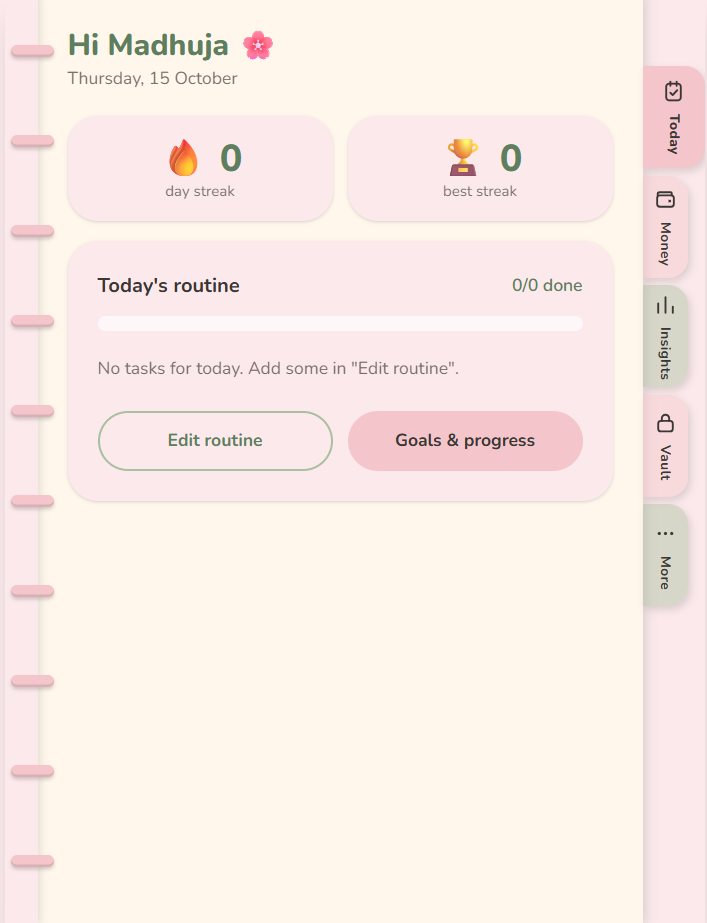

# Tracko 🌸

**Your routine, your money and your private notes in one little pink notebook.**

Tracko is a full-stack web app (installable on phone and laptop) that helps you build daily habits, track money in rupees and keep a private encrypted vault. It looks like a diary: cream pages, binding rings on the left, index tabs on the right edge and pages that flip when you move around.

**Live app:** https://routine-money-tracker.web.app



---

## Features

### Routine
- Daily checklist with a progress bar, and a fresh log for every day
- Edit routine: add, rename, delete tasks and choose the weekdays for each
- Streak and best streak
- Weekly and monthly goals with progress summaries
- In-app reminders at a time you choose (banner and browser notification)
- Goal-based onboarding that gives you a starter routine

### Money
- Income and expenses in rupees, with editable categories
- Edit or delete any entry
- Custom finance month start day (for example, the 5th)
- Monthly budgets, overall and per category, with progress bars that change colour
- Savings goals with a filling jar, a savings log and a progress bar
- Recurring bills (weekly, monthly, yearly) with "Mark paid" and "Skip"

### Insights
- Routine: last 7 days, last 4 weeks, a 5-week calendar heatmap and habit consistency
- Money: income vs spending (6 months), daily spending, savings progress

### Private vault
- Has its own password, separate from your login
- Items are encrypted on your device before they are saved
- Recovery key shown once, auto-lock, search and filters

### Look and feel
- 5 colour palettes (Blush, Lavender, Mint, Sky, Peach)
- Light, Dark and Auto modes, saved to your account
- Works on phone and laptop, and installs as an app (PWA)

### Your data, your control
- Download your data as CSV files or one full backup file
- "Delete my account" asks for your password (or Google confirmation) and removes everything
- Plain-language privacy page

---

## Tech stack

| Part | Technology |
|---|---|
| Screens | React (built with Vite) |
| Styling | Tailwind CSS |
| Login | Firebase Authentication (email and password, and Google) |
| Database | Cloud Firestore with strict security rules |
| Hosting | Firebase Hosting |
| App install | PWA (web manifest and service worker) |
| Code | GitHub, with a commit after every step |

---

## Security

- **Firestore rules:** each person can only read and write their own data. Every write is checked for the right fields and sizes, and anything not listed is closed by default.
- **Vault:** items are encrypted in the browser before they reach the database, so the server only stores scrambled data.
- **Secrets:** Firebase keys live in a private `.env.local` file that is never committed. (The keys in a built web app are public by design. The database rules are what protect the data.)
- **Account deletion:** requires re-entering the password, then removes the user's data and login.

---

## Project structure

```
src/
  pages/        one file per screen
  components/   shared pieces (page flip, side tabs, charts, vault screens)
  services/     code that saves to Firebase
  hooks/        code that reads live data
  utils/        helpers for dates, money, streaks and encryption
  context/      login, theme and vault state
public/         manifest, icons and service worker
```

---

## Run it on your computer

You need Node.js and your own Firebase project.

```bash
git clone https://github.com/madhuja-s/Tracko.git
cd Tracko
npm install
```

1. Create a Firebase project and turn on **Authentication** (email/password and Google) and **Firestore**.
2. Create a file called `.env.local` in the project root with your Firebase web app keys. The variable names are used in `src/firebase.js`.
3. Publish the rules from `firestore.rules` in the Firebase console.

```bash
npm run dev
```

## Build and deploy

```bash
npm run build
firebase deploy --only hosting
```

---

## What I learned

- Designing a secure data model with Firestore rules, not only a working one
- Client-side encryption for a private vault
- Building a PWA that installs and updates properly on phones
- Making one layout work well on both phone and laptop
- Turning real feedback from friends into fixes

---

Built by **Madhuja Suryawanshi** · React + Firebase · 2026
